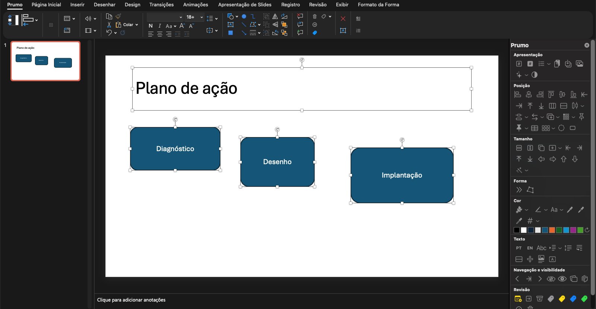

# Prumo

Suplemento gratuito para o **PowerPoint no Mac** que acelera o trabalho braçal de montar slides: alinhar, dimensionar, distribuir, padronizar cores e margens, numerar páginas, criar agenda e revisar.



- **Painel lateral fixo**, preso à borda direita da janela, com mais de 100 ações a um clique e a descrição de cada uma ao passar o mouse.
- **Aba Prumo no ribbon**, que junta numa só aba os comandos nativos mais usados e as ferramentas de revisão.
- **100% offline:** não envia nada para a internet, não tem conta nem telemetria.
- Código aberto (MIT), escrito do zero em VBA e Swift.

> A interface está em português. O Prumo foi feito e testado no PowerPoint para Mac (Microsoft 365, Apple Silicon e Intel, macOS 12 ou mais novo). No Windows não funciona.

## Instalação

### Jeito rápido (recomendado)

1. Abra o **Terminal** (Cmd+Espaço, digite "Terminal", Enter).
2. Cole a linha abaixo e tecle Enter:

   ```sh
   curl -fsSL https://raw.githubusercontent.com/gbrein/prumo/main/install.sh | sh
   ```

3. Se o macOS perguntar se o Terminal pode controlar o PowerPoint, clique em **Permitir**.
4. Se o PowerPoint perguntar sobre macros, clique em **Ativar Macros**.
5. Pronto: a aba **Prumo** aparece no ribbon e o painel abre à direita da janela. Se o painel não aparecer, feche e abra o PowerPoint.

O script ([install.sh](install.sh)) baixa a versão mais recente da página de [Releases](https://github.com/gbrein/prumo/releases) e guarda os arquivos em `~/Library/Application Support/Microsoft/Prumo/`. Essa é a pasta que o PowerPoint consegue ler. Depois, o script registra o suplemento para carregar sempre que o PowerPoint abrir.

### Jeito manual

1. Na página de [Releases](https://github.com/gbrein/prumo/releases/latest), baixe `Prumo.ppam`, `libprumo.dylib` e `Prumo.applescript`.
2. No Terminal, na pasta onde os arquivos foram baixados (normalmente Downloads):

   ```sh
   cd ~/Downloads && sh -c "$(curl -fsSL https://raw.githubusercontent.com/gbrein/prumo/main/install.sh)" -- .
   ```

   Ou, sem script: crie a pasta `~/Library/Application Support/Microsoft/Prumo/`, coloque os três arquivos nela e rode `xattr -d com.apple.quarantine` em cada um. Esse comando tira a marca de "baixado da internet", que faria o macOS bloquear o painel. Depois, no PowerPoint, vá em **Ferramentas › Suplementos do PowerPoint › +** e escolha o `Prumo.ppam`. Na janela de arquivo, Cmd+Shift+G abre a caixa para colar o caminho.

### Atualizar

Rode de novo o comando do jeito rápido e reinicie o PowerPoint.

### Desinstalar

1. No PowerPoint, vá em **Ferramentas › Suplementos do PowerPoint**, selecione **Prumo** e clique em **−**.
2. Apague a pasta:

   ```sh
   rm -rf ~/Library/Application\ Support/Microsoft/Prumo ~/Library/Application\ Scripts/com.microsoft.Powerpoint/Prumo.scpt
   ```

## Como usar

**A última forma clicada é a referência.** Selecione as formas que vão mudar e, por último, com Shift, a forma que serve de modelo. Alinhar, igualar tamanho, esticar, encostar e copiar cor seguem sempre essa última forma.

Botões com uma setinha (˅) têm variações: clique na setinha para ver o menu. No painel e no ribbon, parar o mouse sobre um botão mostra o que ele faz. O **X** do painel esconde o painel, e o botão **Painel** do ribbon traz de volta.

## Funcionalidades

### Apresentação
| Ação | O que faz |
|---|---|
| Numerar páginas | Põe o número em todos os slides; a capa fica sem. Também tira os números. |
| Agenda | Cria um slide "Agenda" antes de cada seção da apresentação, com o item da vez em destaque. Rodar de novo atualiza a agenda; também há uma opção para apagá-la. |
| Colar nos slides | Cola o que está na área de transferência em todos os slides selecionados nas miniaturas. |
| Salvar selecionados | Salva só os slides selecionados num arquivo novo. |
| Slides como imagem | Insere os slides selecionados como imagens num slide novo. |
| Limpeza | Remove animações, anotações, textos alternativos ou layouts não usados (sempre pede confirmação). |
| Preto e branco | Liga e desliga a visualização em preto e branco. |

### Posição
| Ação | O que faz |
|---|---|
| Alinhar | À esquerda, ao centro, à direita, ao topo, ao meio ou à base da última forma. |
| Encostar | Cola a forma ao lado, acima ou abaixo da última, sem espaço. |
| Empilhar | Põe as formas lado a lado ou uma embaixo da outra, sem espaço. |
| Distribuir | Distribui na horizontal ou na vertical; abre ou fecha o espaço de 1 em 1 mm. |
| Trocar | Troca a posição de duas formas: pelo canto, pelos centros, só na horizontal ou só na vertical. |
| Duplicar | Duplica a forma em fileira: para a direita, a esquerda, cima ou baixo. |
| Centralizar no canto | Centraliza a forma num dos cantos da última. |
| Memória | Memoriza a posição e o tamanho de uma forma e aplica em outras: tudo, só a posição, só o tamanho, só a largura ou só a altura, com 9 pontos de âncora. |
| Encaixar na tabela | Encaixa as formas nas células de uma tabela selecionada junto. |
| Grade, círculo, proporção áurea | Organiza as formas em grade (2 a 6 colunas) ou em círculo, ou deixa a altura igual à largura ÷ 1,618. |

### Tamanho
| Ação | O que faz |
|---|---|
| Mesma largura, altura ou tamanho | Iguala à última forma. |
| Ajuste fino | Largura e altura +1 mm ou −1 mm. |
| Esticar | Estica até a borda esquerda, direita, de cima ou de baixo da última. |
| Preencher | Estica até a forma vizinha (ou até a borda do slide) na direção escolhida. |
| Redimensionar em % | Muda o tamanho, a espessura da linha e a fonte juntos (50% a 200%, ou um valor seu). |

### Forma e cor
| Ação | O que faz |
|---|---|
| Cadeia de processo | Encaixa setas e chevrons lado a lado. |
| Igualar pontas e cantos | Copia o formato das pontas de seta e o arredondamento dos cantos da última. |
| Repetir a última cor | Aplica de novo a última cor usada no preenchimento, na linha ou no texto. |
| Cores do tema | Amostras das cores do tema para aplicar com um clique. |
| Copiar cor | Copia o preenchimento, a linha ou a cor do texto da última. |
| Tema ↔ RGB | Converte as cores do tema em RGB fixo, e o contrário. |

### Texto
| Ação | O que faz |
|---|---|
| PT / EN | Define o idioma de revisão (português ou inglês) da seleção ou, sem seleção, da apresentação inteira. |
| Ortografia | Abre a verificação ortográfica. |
| Margens internas | +1 mm, −1 mm ou zero, em todos os lados ou num lado só. |
| Ajustar ao texto, quebrar texto | Ajusta a forma ao texto; liga ou desliga a quebra de linha. |
| Dividir e juntar | Divide uma caixa em uma por parágrafo, ou junta várias caixas numa só. |
| Nota de rodapé | Insere uma nota de rodapé no slide. |
| Substituir textos | Troca ou apaga o texto de todas as formas selecionadas de uma vez. |

### Navegação e revisão
| Ação | O que faz |
|---|---|
| Ir para o slide | Slide anterior, próximo, ou ir direto para um número. |
| Ocultar e reexibir | Esconde as formas selecionadas e reexibe as escondidas do slide. |
| Formas do mestre | Mostra ou esconde as formas do slide mestre. |
| Selecionar parecidas | Seleciona as formas do slide parecidas com a última. |
| Comentários | Caixa amarela com suas iniciais e a data, pronta para digitar; ir para o próximo comentário; apagar todos. |
| Stickers de status | Etiquetas de rascunho, em andamento, revisar e pronto; ir para o próximo sticker; apagar todos. |

## Limitações conhecidas

- **Só no Mac.** O painel é um componente nativo do macOS.
- Ortografia, preto e branco, slides como imagem e salvar selecionados usam recursos do PowerPoint que podem se comportar diferente conforme a versão do Office. Se algo não funcionar, [abra uma issue](https://github.com/gbrein/prumo/issues).
- **Se o PowerPoint travar ao abrir por causa do painel**, crie o arquivo `disable` na pasta do Prumo. O painel deixa de carregar, e o resto continua funcionando:

  ```sh
  touch ~/Library/Application\ Support/Microsoft/Prumo/disable
  ```

## Privacidade

O Prumo roda inteiro no seu Mac. A única informação pessoal que ele lê é o seu nome de usuário do macOS, para as iniciais dos comentários, e ela nunca sai do computador.

## Para desenvolvedores

| Pasta | Conteúdo |
|---|---|
| `src/*.bas` | O VBA: `modLayout` (posição e tamanho), `modText` (texto e cor), `modSlides` (apresentação e revisão), `modRibbon` (despacho das ações), `modPanel` (gerado), `modTests` (autoteste e montagem). |
| `src/customUI14.xml`, `src/icons/` | O ribbon e os ícones próprios dele. |
| `panel/` | O painel em Swift (`PrumoPainel.swift`), o construtor em C (`ctor.c`) e o AppleScript das iniciais. |
| `build/` | `build.py` (injeta o ribbon e gera o `.ppam`), `gen_panel.py` (gera `modPanel.bas`), `icons.swift` (gera os PNGs). |

### Montar o `.ppam`

O editor de VBA do Mac não tem modelo de objetos, e o "Salvar como" do Mac não oferece o formato `.ppam`. Por isso a montagem tem um passo manual:

1. PowerPoint › nova apresentação › Ferramentas › Macro › Editor do Visual Basic (descarregue antes o Prumo instalado).
2. Arquivo › Importar arquivo…: importe os 6 arquivos `src/*.bas`. Depois, Depurar › Compilar.
3. Rode a macro `Prumo_SelfTest`, que exercita as ações numa apresentação temporária. Depois rode `Prumo_BuildAddIn`, que salva `dist/Prumo.pptm` (ajuste o caminho em `modTests.bas` para o seu clone).
4. `python3 build/build.py dist/Prumo.pptm` injeta o ribbon e os ícones, tira os metadados pessoais e gera `dist/Prumo.ppam`.
5. `panel/build.sh` compila o painel (universal, macOS 12+) e o instala. Depois, `sh install.sh dist` instala o resto a partir da pasta local.

Regras da casa:
- Os `.bas` ficam em ASCII com CRLF; os testes conferem.
- Cada `Case` de `modRibbon.bas` cabe numa linha só.
- Depois de mudar um `Case`, rode `python3 build/gen_panel.py`.
- Recursos que talvez não existam no VBA do Mac usam ligação tardia (`Object`).
- O painel já carregado só é trocado reiniciando o PowerPoint.

### Como o painel funciona

A `libprumo.dylib` é carregada **dentro** do PowerPoint: o VBA faz `dlopen` quando o suplemento carrega. Ela entra como mais uma coluna no divisor da janela, ao lado dos painéis nativos. Cada botão roda a macro `PrumoP_<id>` com um Apple event do PowerPoint para ele mesmo, sem pedir permissão. Os arquivos ficam em `~/Library/Application Support/Microsoft/`, a única pasta da casa que o sandbox do PowerPoint lê.

### Testes

- `python3 tests/test_build.py` confere:
  - a injeção do ribbon e dos ícones;
  - a remoção dos metadados;
  - que todo botão tem ação no VBA;
  - que o painel só chama ações que existem;
  - que os `.bas` estão em ASCII com CRLF.
- `Prumo_SelfTest`, no PowerPoint, cria uma apresentação temporária, exercita as ações e fecha sem salvar.

## Licença

[MIT](LICENSE)
