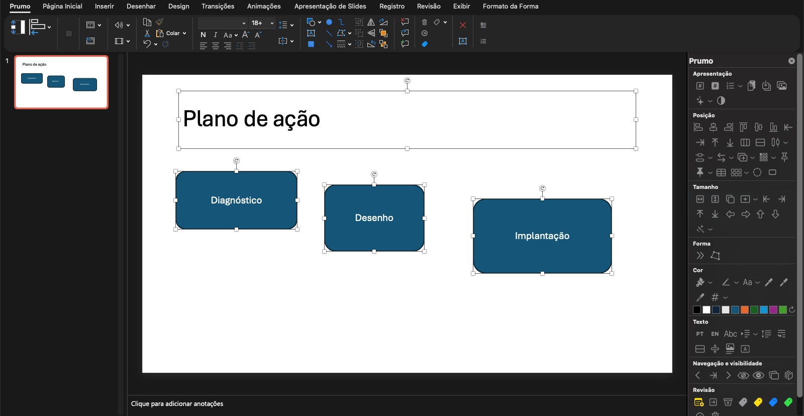

# Prumo

A free add-in for **PowerPoint on Mac and Windows** that speeds up the grunt work of building slides: aligning, sizing, distributing, standardizing colors and margins, numbering pages, building an agenda and reviewing.



- **Docked side panel**, pinned to the right edge of the window, with more than 100 one-click actions and a description of each on hover.
- **Prumo tab on the ribbon**, which puts the most used native commands and the review tools in a single tab.
- **100% offline:** sends nothing to the internet, no account, no telemetry.
- **English and Portuguese:** the interface follows the Office display language (Portuguese if Office is in Portuguese, English otherwise).
- Open source (MIT), written from scratch in VBA, Swift and C#.

> Prumo runs on PowerPoint for Microsoft 365 on Mac (Apple Silicon and Intel, macOS 12 or later) and on Windows (10 or 11). The `.ppam` is the same on both; only the side panel differs: on the Mac it is native Swift, on Windows it is a COM add-in in C#.

## Installing on the Mac

### Quick way (recommended)

1. Open **Terminal** (Cmd+Space, type "Terminal", Enter).
2. Paste the line below and press Enter:

   ```sh
   curl -fsSL https://raw.githubusercontent.com/gbrein/prumo/main/install.sh | sh
   ```

3. If macOS asks whether Terminal may control PowerPoint, click **Allow**.
4. If PowerPoint asks about macros, click **Enable Macros**.
5. Done: the **Prumo** tab shows up on the ribbon and the panel opens on the right of the window. If the panel does not show up, quit and reopen PowerPoint.

The script ([install.sh](install.sh)) downloads the latest version from the [Releases](https://github.com/gbrein/prumo/releases) page and stores the files in `~/Library/Application Support/Microsoft/Prumo/`, the folder PowerPoint is allowed to read. Then it registers the add-in to load every time PowerPoint opens.

### Manual way

1. From the [Releases](https://github.com/gbrein/prumo/releases/latest) page, download `Prumo.ppam`, `libprumo.dylib` and `Prumo.applescript`.
2. In Terminal, in the folder where the files were downloaded (usually Downloads):

   ```sh
   cd ~/Downloads && sh -c "$(curl -fsSL https://raw.githubusercontent.com/gbrein/prumo/main/install.sh)" -- .
   ```

   Or, without the script: create the folder `~/Library/Application Support/Microsoft/Prumo/`, put the three files in it and run `xattr -d com.apple.quarantine` on each. That command removes the "downloaded from the internet" flag, which would make macOS block the panel. Then, in PowerPoint, go to **Tools › PowerPoint Add-ins › +** and pick `Prumo.ppam`. In the file dialog, Cmd+Shift+G opens a box to paste the path.

### Updating

Run the quick-way command again and restart PowerPoint.

### Uninstalling (Mac)

1. In PowerPoint, go to **Tools › PowerPoint Add-ins**, select **Prumo** and click **−**.
2. Delete the folder:

   ```sh
   rm -rf ~/Library/Application\ Support/Microsoft/Prumo ~/Library/Application\ Scripts/com.microsoft.Powerpoint/Prumo.scpt
   ```

## Installing on Windows

1. Close PowerPoint.
2. Open **PowerShell** (Windows key, type "PowerShell", Enter), paste the line below and press Enter:

   ```powershell
   & ([scriptblock]::Create((irm https://raw.githubusercontent.com/gbrein/prumo/main/win/install.ps1)))
   ```

3. Open PowerPoint. The **Prumo** tab shows up on the ribbon and the panel opens on the right. If PowerPoint asks about macros, click **Enable**.

The script ([win/install.ps1](win/install.ps1)) downloads `Prumo.ppam` and `PrumoPanel.dll` from the [Releases](https://github.com/gbrein/prumo/releases) page into `%APPDATA%\Prumo\` and registers both for your user only, without asking for administrator rights. To update, run the same line again.

To uninstall, close PowerPoint and run the same line with `-Uninstall` at the end. With the files already downloaded to a folder, use `-From C:\path\to\folder` instead.

## How to use

**The last shape clicked is the reference.** Select the shapes that will change and, last, with Shift, the shape that serves as the model. Align, match size, stretch, dock and copy color always follow that last shape.

Buttons with a small arrow (˅) have variants: click the arrow to see the menu. In the panel and on the ribbon, hovering over a button shows what it does. The panel's **X** hides the panel, and the ribbon's **Panel** button brings it back.

## Features

### Presentation
| Action | What it does |
|---|---|
| Number pages | Puts the number on every slide; the cover gets none. Also removes the numbers. |
| Agenda | Creates an "Agenda" slide before each section of the presentation, with the current item highlighted. Running it again updates the agenda; there is also an option to delete it. |
| Paste on slides | Pastes the clipboard on every slide selected in the thumbnails. |
| Save selected | Saves only the selected slides to a new file. |
| Slides as pictures | Inserts the selected slides as pictures on a new slide. |
| Cleanup | Removes animations, notes, alt texts or unused layouts (always asks first). |
| Black and white | Turns the black and white view on and off. |

### Position
| Action | What it does |
|---|---|
| Align | Left, center, right, top, middle or bottom of the last shape. |
| Dock | Moves the shape right next to, above or below the last one, with no gap. |
| Stack | Places the shapes side by side or one below the other, with no gap. |
| Distribute | Distributes horizontally or vertically; widens or tightens the gap 1 mm at a time. |
| Swap | Swaps the position of two shapes: by corner, by centers, horizontally only or vertically only. |
| Duplicate | Duplicates the shape in a row: to the right, left, up or down. |
| Center on corner | Centers the shape on one of the corners of the last one. |
| Memory | Memorizes a shape's position and size and applies them to others: all, position only, size only, width only or height only, with 9 anchor points. |
| Fit into table | Fits the shapes into the cells of a table selected along with them. |
| Grid, circle, golden ratio | Arranges the shapes in a grid (2 to 6 columns) or in a circle, or makes the height equal to the width ÷ 1.618. |

### Size
| Action | What it does |
|---|---|
| Same width, height or size | Matches the last shape. |
| Fine tuning | Width and height +1 mm or −1 mm. |
| Stretch | Stretches to the left, right, top or bottom edge of the last shape. |
| Fill | Stretches to the neighboring shape (or the slide edge) in the chosen direction. |
| Resize by % | Changes size, line weight and font together (50% to 200%, or your own value). |

### Shape and color
| Action | What it does |
|---|---|
| Process chain | Fits arrows and chevrons side by side. |
| Match tips and corners | Copies the arrowhead shape and the corner rounding of the last shape. |
| Repeat the last color | Reapplies the last color used for fill, line or text. |
| Theme colors | Theme color swatches to apply with one click. |
| Copy color | Copies the fill, line or text color of the last shape. |
| Theme ↔ RGB | Converts theme colors to fixed RGB, and back. |

### Text
| Action | What it does |
|---|---|
| PT / EN | Sets the proofing language (Portuguese or English) of the selection or, with no selection, of the whole presentation. |
| Spelling | Opens the spell check. |
| Inner margins | +1 mm, −1 mm or zero, on all sides or on one side. |
| Fit to text, wrap text | Fits the shape to the text; turns word wrap on or off. |
| Split and merge | Splits a box into one per paragraph, or merges several boxes into one. |
| Footnote | Inserts a footnote on the slide. |
| Replace texts | Replaces or deletes the text of all selected shapes at once. |

### Navigation and review
| Action | What it does |
|---|---|
| Go to slide | Previous slide, next slide, or jump straight to a number. |
| Hide and show | Hides the selected shapes and shows the hidden ones on the slide again. |
| Master shapes | Shows or hides the slide master shapes. |
| Select similar | Selects the shapes on the slide that are similar to the last one. |
| Comments | Yellow box with your initials and the date, ready to type; go to the next comment; delete all. |
| Status stickers | Draft, in progress, review and done labels; go to the next sticker; delete all. |

## Language

Prumo picks its language once, when PowerPoint starts, from the Office display language: Portuguese if Office is in Portuguese (Brazil or Portugal), English for any other language. This covers the ribbon, the side panel, the questions and the messages. To switch, change the Office display language and restart PowerPoint. Stickers, footnotes and comments inserted on slides keep the language they were created in.

## Known limitations

- **Different icons on Windows.** The Windows panel uses Office's own icons and symbols from the Segoe UI Symbol font, because the Mac icons (SF Symbols) may only be used on Apple systems. The actions are the same.
- **On Windows, questions and notices** show up in PowerPoint's own dialog boxes, not in the panel footer.
- Spelling, black and white, slides as pictures and save selected use PowerPoint features that may behave differently depending on the Office version. If something does not work, [open an issue](https://github.com/gbrein/prumo/issues).
- **If PowerPoint freezes on startup because of the panel**, create a file named `disable` in the Prumo folder. The panel stops loading, and everything else keeps working:

  ```sh
  touch ~/Library/Application\ Support/Microsoft/Prumo/disable
  ```

## Privacy

Prumo runs entirely on your computer. The only personal information it reads is your name, for the comment initials: on the Mac, the macOS user name; on Windows, the Office user name. It never leaves the computer.

## For developers

| Folder | Contents |
|---|---|
| `src/*.bas` | The VBA: `modLayout` (position and size), `modText` (text and color), `modSlides` (presentation and review), `modRibbon` (action dispatch and the `Tx` language helper), `modPanel` and `modUi` (generated), `modTests` (self-test and build). |
| `src/customUI14.xml`, `src/icons/` | The ribbon and its own icons. |
| `panel/` | The Mac panel in Swift (`PrumoPainel.swift`), the C constructor (`ctor.c`) and the AppleScript for the initials. |
| `win/` | The Windows panel in C# (`PrumoPanel.cs`), the generated button list (`panel.tsv`), the build (`build.ps1`) and the installer (`install.ps1`). |
| `build/` | `build.py` (injects the ribbon and builds the `.ppam`), `gen_panel.py` (generates `modPanel.bas`, `modUi.bas` and `win/panel.tsv`), `icons.swift` (generates the PNGs). |

### Building the `.ppam` on the Mac

The Mac VBA editor has no object model, and the Mac "Save As" does not offer the `.ppam` format. So the build has a manual step:

1. PowerPoint › new presentation › Tools › Macro › Visual Basic Editor (unload the installed Prumo first).
2. File › Import File…: import the 7 `src/*.bas` files. Then Debug › Compile.
3. Run the `Prumo_SelfTest` macro, which exercises the actions in a temporary presentation. Then run `Prumo_BuildAddIn`, which saves `dist/Prumo.pptm` (adjust the path in `modTests.bas` to your clone).
4. `python3 build/build.py dist/Prumo.pptm` injects the ribbon and icons, strips personal metadata and produces `dist/Prumo.ppam`.
5. `panel/build.sh` compiles the panel (universal, macOS 12+) and installs it. Then `sh install.sh dist` installs the rest from the local folder.

### Building on Windows

On Windows, PowerPoint has the VBA object model, so the build is a single command (it needs PowerPoint closed and Python 3; the C# compiler ships with Windows):

```powershell
powershell -ExecutionPolicy Bypass -File win\build.ps1
powershell -ExecutionPolicy Bypass -File win\install.ps1 -From dist
```

`build.ps1` regenerates `win/panel.tsv` and `src/modUi.bas`, compiles `dist/PrumoPanel.dll`, imports the `.bas` files into a new presentation, runs `Prumo_SelfTestRun` and calls `build.py`. To import the VBA, it turns on "Trust access to the VBA project object model" only during the build and restores it afterwards. The `.ppam` built on Windows is the same one that runs on the Mac. For a release, publish `Prumo.ppam`, `libprumo.dylib`, `Prumo.applescript` and `PrumoPanel.dll`.

House rules:
- The `.bas` files are ASCII with CRLF; the tests check it.
- Each `Case` in `modRibbon.bas` fits on a single line.
- After changing a `Case`, a Mac panel button or a ribbon text, run `python3 build/gen_panel.py`: the Mac panel is the source for both panels.
- Mac-only code (`AppleScriptTask`, `dlopen`, `TMPDIR`) stays inside `#If Mac Then`; the tests check it.
- Features that may not exist in Mac VBA use late binding (`Object`).
- A panel that is already loaded is only replaced by restarting PowerPoint.

### Translations

Every user-facing text carries its Portuguese and English versions side by side:

- **Ribbon:** `src/customUI14.xml` has `label="…" labelEn="…"` (same for `screentip`/`supertip`). `build.py` turns them into `getLabel`/`getScreentip`/`getSupertip` callbacks, answered by the generated `modUi.bas`.
- **Panels:** `PrumoPainel.swift` has `tip:`/`tipEN:`, `M("id", "pt", "en")` and `Section(title:, en:)`; `gen_panel.py` copies both into `win/panel.tsv` for Windows.
- **Messages:** `Tx("pt", "en")` in VBA, `L("pt", "en")` in Swift and C#.

The tests fail if a ribbon text or panel entry is missing its English version.

### How the panel works

On the Mac, `libprumo.dylib` is loaded **inside** PowerPoint: the VBA calls `dlopen` when the add-in loads. It becomes one more column in the window's split view, next to the native panes. Each button runs the `PrumoP_<id>` macro through an Apple event from PowerPoint to itself, without asking for permission. The files live in `~/Library/Application Support/Microsoft/`, the only folder in the home directory that PowerPoint's sandbox can read.

On Windows, `PrumoPanel.dll` is a COM add-in without VSTO, registered for the current user only (`HKCU`). It adds a Custom Task Pane, the same docked side pane Office add-ins use, to each presentation window. Each button runs `PrumoP_<id>` via `Application.Run`. The ribbon's **Panel** button reaches it through `COMAddIns("Prumo.Panel").Object.Show`. To troubleshoot, create the file `%TEMP%\prumo_trace`: the panel then logs its steps to `%TEMP%\prumo_panel.log`.

### Tests

- `python3 tests/test_build.py` checks:
  - the ribbon and icon injection;
  - the metadata removal;
  - that every button has a VBA action;
  - that the panel only calls actions that exist;
  - that `win/panel.tsv` and `src/modUi.bas` are up to date;
  - that every ribbon text and panel entry has an English version;
  - that Mac-only code is inside `#If Mac Then`;
  - that the `.bas` files are ASCII with CRLF.
- `Prumo_SelfTest`, in PowerPoint (on Windows, `win\build.ps1` runs it automatically), creates a temporary presentation, exercises the actions and closes without saving.

## License

[MIT](LICENSE)
